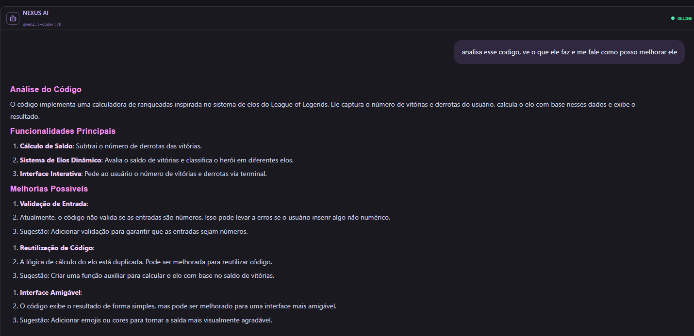
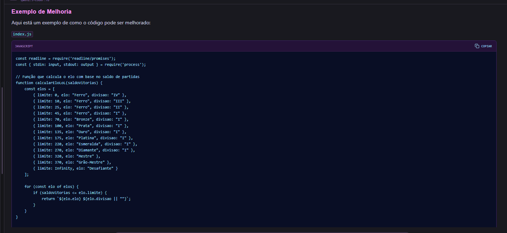

# Nexus Dev

IDE local com IA para conversar sobre projetos, editar código e acompanhar alterações no mesmo lugar.

O Nexus reúne React, Monaco Editor, FastAPI e Ollama em uma interface cyberpunk com roxo e grafite. A V0.6, **Minimal Cyberpunk**, simplifica a tela e dá mais espaço à conversa e ao código.

**[Abrir demo](https://nexus-dev-minimal-demo.regal-tune-3069.chatgpt.site)**

## O Nexus em uso

Capturas da versão local com o modelo `qwen2.5-coder:7b`.





## O que dá para fazer

- Conversar com modelos locais pelo Ollama, com resposta em streaming.
- Escolher os arquivos usados como contexto da conversa.
- Editar código no Monaco e revisar o diff antes de salvar.
- Pedir sugestões de alteração e autocomplete com IA.
- Importar projetos ZIP ou uma cópia de um repositório Git local autorizado.
- Consultar alterações, fazer stage, criar commits e ver o histórico.
- Buscar texto, restaurar backups e exportar o projeto.
- Recolher e redimensionar painéis ou focar só na conversa ou no editor.
- Alternar entre os temas Night City e Protocol 2077.

## Demo e versão local

| | Versão local | Demo pública |
| --- | --- | --- |
| Editor Monaco | Edição de projetos importados | Edição do projeto de exemplo |
| Conversa e autocomplete | Modelos do Ollama | Respostas e sugestões preparadas |
| Git | Operações reais na cópia interna | Histórico e commits simulados |
| Projetos | Importação e exportação ZIP | Exemplo incluído e exportação JSON |
| Dados dos arquivos | Workspace no computador | Temporários; reiniciados ao recarregar |

A demo está na pasta `demo/` e funciona sem backend. Rodar essa pasta no computador continua sendo uma demonstração: isso não ativa o Ollama.

## Rodar no Windows

Tenha Python, Node.js com npm, Git e Ollama instalados. O botão **Code → Download ZIP** permite baixar o código sem usar Git.

1. Extraia o projeto em uma pasta nova.
2. Execute `VERIFICAR_AMBIENTE.bat`.
3. Instale os modelos no Ollama:

```powershell
ollama pull qwen2.5-coder:7b
ollama pull qwen2.5-coder:1.5b
```

4. Com o Ollama aberto, execute `INICIAR_BACKEND.bat`.
5. Execute `INICIAR_FRONTEND.bat` em outra janela.
6. Acesse http://127.0.0.1:5173.

Os scripts preparam as dependências na primeira execução. Mantenha as duas janelas abertas. A API fica em http://127.0.0.1:8000/docs.

O modelo 7B é o padrão do chat; o 1.5B é uma opção mais leve para autocomplete. O tempo de resposta depende do modelo, do contexto e do computador.

## Experimentar o fluxo

Importe `exemplos/demo-python.zip`, abra um arquivo e faça uma alteração. Use `Ctrl+S` para revisar e confirmar a gravação. O Nexus cria um backup antes de salvar.

No painel Git, inicialize o repositório, selecione os arquivos e crie um commit. Para pedir autocomplete, use `Ctrl+Alt+Espaço`; aceite a sugestão com `Tab`. O modo automático pode ser ativado nos ajustes.

O chat analisa o conteúdo salvo. Alterações ainda pendentes no editor precisam ser salvas para entrar no contexto.

## Estrutura

- `backend/`: API FastAPI, Ollama, arquivos, backups e operações Git.
- `frontend/`: interface React/TypeScript, Monaco e painéis.
- `demo/`: versão pública com dados e respostas simulados.
- `docs/`: documentação da API e mudanças da V0.6.
- `exemplos/`: projeto para experimentar a importação.

## Rodar a demo separadamente

Na pasta `demo/`:

```powershell
npm install
npm run dev
```

Acesse http://127.0.0.1:5173. Encerre o frontend da versão local antes, pois ambos usam a mesma porta.

## Verificações

Backend, dentro de `backend/`:

```powershell
python -m pip install -r requirements.txt
python -m pip install pytest
python -m pytest -q
```

Frontend, dentro de `frontend/`:

```powershell
npm install
npm run build
```

Demo, dentro de `demo/`:

```powershell
npm install
node tests/demo.mjs
npm run build
```

Os testes simulados do Ollama verificam os contratos da API. A geração real precisa ser conferida com o Ollama rodando.

## Limites atuais

O aplicativo completo foi feito para uso local, em `127.0.0.1`, e não tem autenticação multiusuário. A demo é a versão preparada para acesso público.

O Git trabalha em uma cópia interna: não altera o repositório original e não faz push, pull ou troca de branches. Por padrão, a importação local aceita projetos em `%USERPROFILE%\Documents\PROJETOS`; outra pasta pode ser configurada com `NEXUS_PROJECT_ROOT` antes de iniciar o backend.

O Nexus não executa o código importado nem oferece um terminal livre. As sugestões da IA passam por revisão antes de serem gravadas.

## Próximos passos

- Dividir o estado da interface em componentes menores.
- Ampliar a cobertura de testes de interface.
- Melhorar a configuração e o retorno de erros das integrações locais.

Desenvolvido por [Marcelo Fraitag](https://github.com/MarceloFraitag).
